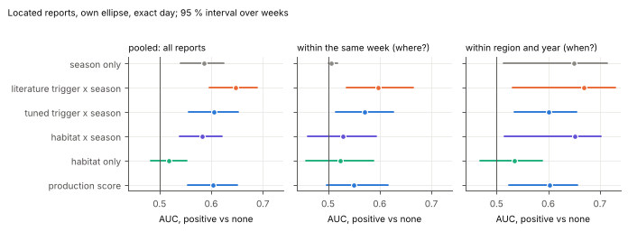
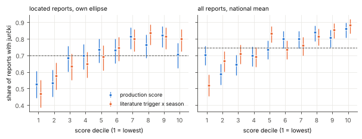
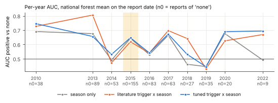
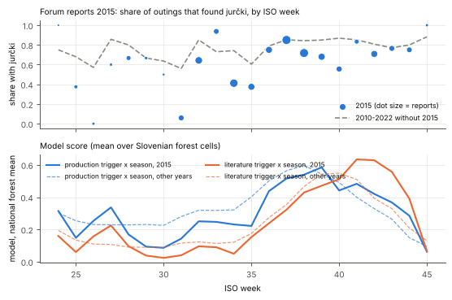
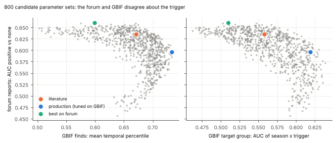

# Backtest against forum reports: presence AND absence

*Reproduce with `python -m jurcki.model.backtest_reports` (about 6 min; writes `data/processed/backtest_reports_results.json` and the figures in
`docs/figures/backtest_*.png`; `--quick` uses fewer bootstrap draws). Nothing here changes the production model or `trigger_params.json`.*

## 0. Summary

This is the first test of the score against people who went out and found **nothing**. The 3,278 gobe.si field reports
(`data/processed/field_reports.parquet`) give 1,704 outings with jurčki and 577 outings without, 2010-2026, after removing cross-posts.
The score was evaluated on the 250 m grid exactly as the app does it (ERA5 weather, lapse-rate shift, tuned trigger, habitat, season table).

* **The weather part works, modestly.** Pooled AUC "outing with jurčki vs outing without": **0.61** for the production score
  (95 % interval 0.57-0.66 over weeks), against **0.58** for the month table alone. 0.5 is a coin flip; the gain of the weather over the calendar is
  +0.035 [+0.008, +0.062].
* **The literature trigger beats the GBIF-tuned trigger on this data** (0.65 vs 0.60 at the report's own location; difference -0.042 for tuned
  [-0.075, -0.002]; with national means for all 2,281 reports -0.025 [-0.057, +0.010]). The GBIF target-group test says the opposite (tuned +0.061 over
  literature [+0.02, +0.10]). The two data sets disagree about the trigger (section 5).
* **Habitat adds nothing here** (production score minus the same without habitat: -0.001). Within the same week, which tests the "where" part, the
  production score reaches only 0.55 [0.50, 0.62] and habitat alone 0.52 [0.46, 0.59]. People report from forest they already know is good, so
  this test says little against the habitat map (section 3.3).
* **2015** was the worst year of the forum record (62 % of outings with jurčki, 77 % in the other years). The model also marked 2015 as below normal
  (July-August trigger about half of a typical year) but did not predict any extra flush in September: the forum shows the success rate *returning to
  normal* in weeks 36-39, not exceeding it (section 4).
* **Retuning: no change recommended.** Fitting the trigger on the forum alone raises held-out AUC from 0.596 to 0.656 (+0.060 [+0.02, +0.10]), but the
  same parameters lose 0.11 on the GBIF target-group metric. Every compromise either loses the GBIF target-group skill or the forum gain is not
  distinguishable from 0. `data/processed/trigger_params_forum.json` was **not** written.
* **Elevation optimum by month:** no gain on the forum (held-out -0.010 [-0.030, +0.012]); the experimental `elev_season` factor gains +0.010
  [-0.008, +0.028] there, which is not significant.
* Gazetteer: 56 more reports got coordinates (located 1,775 -> 1,831 of 3,278, 54.1 % -> 55.9 %).

## 1. Data, units, what was scored

**Reports used.** `jurcki_outcome` in {found, few, many} is "positive", {none} is "negative"; `unclear` and `not_mentioned` are left out.
Of 2,572 such reports, **217 (8.4 %) are older than 2010** and cannot be scored (ERA5 starts 2010-01-01). 2,355 remain.

**Duplicates.** The local post table has a hashed author for 96 % of the reports, so a duplicate is: same author, same outcome, within one day,
same place (or one of them unlocated). Without the author file (it is not committed) the rule falls back to same place name + same outcome +/-1 day, and
unlocated posts are not compared. 74 duplicates were dropped, **2,281 reports analysed** (373 distinct authors), of which **1,389 are located**.
Because a few authors dominate (the top 5 write 22 % of them), three sensitivity checks follow: each author-week counted once, the top 5 authors
removed, and cluster bootstrap intervals over weeks, over authors and over years.

**Scopes.** For a located report the score is the mean over (up to 100 sampled) forest cells (`habitat > 0.05`) inside its location ellipse /
circle (`cell`). The `region` scope is the mean over the report's statistical region, the `national` scope the mean over 3,000 random forest cells
of Slovenia on that date; the last one works for **every** report including the 892 without coordinates. The trigger at a cell is *identical* to
`predict.iter_trigger` (checked to 1e-5 in the tests). A tolerance of +/-1 or 3 days means: the maximum over those days at each cell, then the mean over cells.

**Scores.** `season` = the month step table. `hab` = habitat alone. `hab_season` = habitat x season (no weather). `comb_lit` / `comb_tuned` = season x literature / tuned trigger.
`full_tuned` = habitat x season x tuned trigger, **the production score** (before the fixed rescaling, which does not change a ranking).
`@es` = times the experimental elevation x day-of-year factor.

## 2. Pooled AUC: outing with jurčki vs outing without

Located reports, own ellipse, exact day (n = 973 with / 416 without). Intervals: 95 %, bootstrap over ISO weeks (authors / years in the JSON).

| score | AUC | 95 % (weeks) | 95 % (authors) | 95 % (years) |
|---|---|---|---|---|
| season only | 0.585 | 0.540-0.624 | 0.548-0.622 | 0.521-0.642 |
| habitat only | 0.517 | 0.483-0.553 | 0.469-0.569 | 0.451-0.557 |
| habitat x season | 0.582 | 0.538-0.621 | 0.544-0.621 | 0.511-0.638 |
| literature trigger x season | **0.647** | 0.596-0.689 | 0.607-0.685 | 0.590-0.683 |
| tuned trigger x season | 0.605 | 0.557-0.653 | 0.565-0.643 | 0.551-0.643 |
| **production score** (habitat x season x tuned) | 0.604 | 0.555-0.650 | 0.565-0.644 | 0.547-0.646 |
| habitat x season x literature trigger | 0.648 | 0.600-0.690 | 0.609-0.687 | 0.585-0.682 |
| tuned x season x elev-season | 0.616 | 0.567-0.660 | 0.577-0.652 | 0.564-0.651 |
| production x elev-season | 0.614 | 0.566-0.660 | 0.574-0.653 | 0.556-0.654 |

All 2,281 reports, national forest mean on the report date (the "unlocated" variant, also valid for the located ones):

| score | AUC | 95 % (weeks) |
|---|---|---|
| season only | 0.578 | 0.537-0.615 |
| literature trigger x season | 0.638 | 0.592-0.682 |
| tuned trigger x season | 0.613 | 0.569-0.658 |
| production score | 0.613 | 0.569-0.657 |

(`habitat` is constant for a national mean, so it adds nothing there; the same 973 located reports scored nationally give 0.586 / 0.639 / 0.629.)
The regional mean sits in between (0.585 / 0.629 / 0.609; JSON).

**Paired differences** (AUC of the first minus the second; interval over weeks, then over years):

| comparison | located (own ellipse) | all reports (national) |
|---|---|---|
| literature x season - season | +0.061 [+0.026, +0.097]; years [+0.037, +0.084] | +0.060 [+0.024, +0.090] |
| tuned x season - season | +0.019 [-0.016, +0.054] | +0.035 [+0.008, +0.062] |
| tuned - literature | **-0.042** [-0.075, -0.002]; years [-0.078, -0.008] | -0.025 [-0.057, +0.010] |
| production - tuned x season (= habitat) | -0.001 [-0.010, +0.008] | -0.001 [-0.002, +0.001] |
| production - habitat x season (= weather) | +0.022 [-0.013, +0.059] | +0.034 [+0.008, +0.062] |
| tuned x season x elev-season - tuned x season | +0.011 [-0.007, +0.030]; years [-0.000, +0.022] | -0.006 [-0.012, -0.001] |

**Tolerance** (AUC; exact day / +/-1 / +/-3 days). The tolerant variants are not better; the finds here are dated to the day, so smearing the
day only blurs it.

| scope | score | 0 | +/-1 | +/-3 |
|---|---|---|---|---|
| located | season | 0.585 | 0.585 | 0.575 |
| located | literature x season | 0.647 | 0.645 | 0.639 |
| located | tuned x season | 0.605 | 0.605 | 0.598 |
| located | production | 0.604 | 0.604 | 0.596 |
| national | literature x season | 0.638 | 0.632 | 0.623 |
| national | tuned x season | 0.613 | 0.610 | 0.606 |

**Does a better score also mean more fruit?** AUC against "none" for each size of find (national means; the located version is similar):

| positive class | n | season | lit x season | tuned x season | production |
|---|---|---|---|---|---|
| few | 690 | 0.558 | 0.606 | 0.586 | 0.585 |
| found | 735 | 0.561 | 0.644 | 0.596 | 0.595 |
| many | 279 | 0.673 | 0.705 | 0.727 | 0.726 |

The score rises with the size of the find: "many" is separated best, "few" is hardly different from "none".

### 2.1 Sensitivity (national scope, AUC)

| report set | n pos / none | season | lit x season | tuned x season | production |
|---|---|---|---|---|---|
| all deduplicated | 1704 / 577 | 0.578 | 0.638 | 0.613 | 0.613 |
| outings only (no second-hand, no status) | 1501 / 506 | 0.587 | 0.642 | 0.615 | 0.614 |
| date uncertainty <= 1 day | 1491 / 512 | 0.573 | 0.638 | 0.602 | 0.602 |
| each author-week counted once | 1704 / 577 | 0.572 | 0.632 | 0.602 | 0.602 |
| without the 5 most active authors | 1331 / 446 | 0.582 | 0.644 | 0.618 | 0.617 |
| without 2015 | 1450 / 422 | 0.567 | 0.636 | 0.596 | 0.595 |
| only 2013-2020 | 1447 / 525 | 0.573 | 0.631 | 0.604 | 0.603 |
| only August-October | 1255 / 384 | 0.587 | 0.654 | 0.625 | 0.624 |

Nothing moves by more than about 0.02: the result does not hinge on one author, one year, or the vaguer report kinds. Without Podravska
(Pohorje / Maribor, 42 % of the located reports) the located AUCs are 0.566 / 0.651 / 0.599 / 0.597.

## 3. Where and when separately

### 3.1 Within the same week (tests the spatial part)

Only pairs of reports from the same ISO week are compared, so the season and most of the weather of the week cancel; what is left is "where".
Located reports, 95 % interval from resampling weeks.

| score | AUC within week | 95 % |
|---|---|---|
| season only (cannot discriminate inside a week) | 0.506 | 0.500-0.518 |
| habitat only | 0.523 | 0.457-0.589 |
| habitat x season | 0.528 | 0.462-0.593 |
| literature x season | **0.597** | 0.536-0.666 |
| tuned x season | 0.570 | 0.515-0.626 |
| production | 0.550 | 0.497-0.615 |

There is a little spatial skill, and it comes from the *weather* part (the trigger differs between places in the same week: elevation, rain), not from
habitat. With national means the within-week AUC is 0.53 for every weather score and 0.51 for season: that part is only the day-to-day change inside a week.

### 3.2 Within the same place (tests the timing part)

Pairs from the same statistical region; "across years" lets the years differ, "same year" keeps only reports of one region in one season (pure timing).

| score | same region, all years | 95 % | same region and year | 95 % |
|---|---|---|---|---|
| season only | 0.605 | 0.516-0.674 | 0.649 | 0.514-0.714 |
| habitat only | 0.528 | 0.479-0.567 | 0.534 | 0.469-0.588 |
| literature x season | 0.642 | 0.566-0.695 | **0.669** | 0.531-0.730 |
| tuned x season | 0.610 | 0.542-0.654 | 0.602 | 0.534-0.655 |
| production | 0.608 | 0.538-0.652 | 0.602 | 0.523-0.656 |

Most of the skill is *timing*: late-season and September outings succeed more often than May-July ones (the month table alone gives 0.65 within a
region and year), and the literature trigger adds about +0.02 to that.

### 3.3 Why habitat does not show up

The negative reports are written by people who went to places they believe to be good. Habitat differences between "my usual spot" and
"my usual spot" are small, so the habitat map cannot separate those outings, and the habitat model was trained to separate forest from non-forest and
good from poor sites by finds, not to rank spots that pickers already choose. The test is therefore weak evidence for or against the habitat map; a
random-location absence data set (not outings) would be needed.

### 3.4 Calibration

Share of outings with jurčki by decile of the score (located; production score):

| decile | 1 | 2 | 3 | 4 | 5 | 6 | 7 | 8 | 9 | 10 |
|---|---|---|---|---|---|---|---|---|---|---|
| share with jurčki | 0.53 | 0.53 | 0.68 | 0.70 | 0.73 | 0.73 | 0.81 | 0.76 | 0.82 | 0.71 |
| mean score (before rescaling) | 0.04 | 0.10 | 0.16 | 0.21 | 0.26 | 0.31 | 0.36 | 0.40 | 0.43 | 0.49 |

The two lowest deciles find jurčki on about half the outings, the middle to upper deciles on 70-80 %. The **top decile of the production score is worse
than deciles 7-9** (0.71 vs 0.82, intervals 0.63-0.77 vs 0.75-0.88); the literature trigger has no such drop (top three deciles 0.80-0.84). Never above
0.84: even "perfect weather" outings return empty-handed one time in five. With the national mean (all reports) the production score rises broadly
(0.59-0.70 in the lowest deciles to 0.86 in the highest). The share of reports with jurčki is higher than a "true" success rate because people report successes
more often than failures (the overall base rate is 75 %).

## 4. Years, and 2015

### 4.1 Per-year AUC (national mean, all reports)

AUC positive-vs-none in each year; blank = no outing without jurčki that year (AUC undefined). `cell` columns use the located reports only.

| year | n with / none | season | lit x season | tuned x season | production | cell: lit x season | cell: tuned x season | cell: production |
|---|---|---|---|---|---|---|---|---|
| 2010 | 145 / 38 | 0.690 | 0.726 | 0.745 | 0.750 | 0.714 | 0.720 | 0.682 |
| 2011 | 10 / 0 | | | | | | | |
| 2012 | 15 / 0 | | | | | | | |
| 2013 | 290 / 89 | 0.676 | 0.806 | 0.656 | 0.658 | 0.714 | 0.596 | 0.580 |
| 2014 | 209 / 53 | 0.490 | 0.471 | 0.530 | 0.527 | 0.506 | 0.511 | 0.483 |
| **2015** | **254 / 155** | 0.643 | 0.619 | 0.647 | 0.643 | 0.676 | 0.631 | 0.644 |
| 2016 | 190 / 83 | 0.529 | 0.540 | 0.541 | 0.541 | 0.621 | 0.553 | 0.578 |
| 2017 | 183 / 63 | 0.664 | 0.697 | 0.672 | 0.671 | 0.718 | 0.690 | 0.715 |
| 2018 | 153 / 27 | 0.461 | 0.641 | 0.531 | 0.536 | 0.666 | 0.611 | 0.591 |
| 2019 | 102 / 35 | 0.446 | 0.430 | 0.444 | 0.445 | 0.544 | 0.490 | 0.509 |
| 2020 | 66 / 20 | 0.676 | 0.625 | 0.689 | 0.689 | 0.561 | 0.616 | 0.646 |
| 2021 | 2 / 0 | | | | | | | |
| 2022 | 63 / 9 | 0.491 | 0.669 | 0.694 | 0.698 | 0.669 | 0.617 | 0.585 |

Within a year the tuned trigger beats the month table in 8 of the 10 testable years (2010, 2013-2020, 2022) and the literature trigger in 6 of 10, but
2014 and 2019 are at chance for all of them (the weather did not separate good from bad days in those seasons), and years with fewer than 30
outings without jurčki (2018, 2020, 2022) are noisy. 2011, 2012, 2021 and 2023-2025 hold almost no reports (missing forum threads, not "no fruiting").

### 4.2 Reported vs predicted season quality, per year

Reported quality = share of outings with jurčki minus what the same half-months give in the average year (calendar mix removed). Predicted quality =
the same for the model score at the report dates (national mean). "Aug15-Oct15 z" is the model's national forest mean in the main season, as a z-score
over 2010-2025 (needs no reports).

| year | outings | share with jurčki | reported vs normal | model vs normal: lit x season | model vs normal: tuned x season | production | Aug15-Oct15 z (tuned) |
|---|---|---|---|---|---|---|---|
| 2010 | 183 | 0.79 | +0.05 | +0.100 | +0.069 | +0.043 | +1.55 |
| 2013 | 379 | 0.77 | +0.01 | +0.028 | -0.005 | -0.002 | -0.07 |
| 2014 | 262 | 0.80 | +0.08 | +0.067 | +0.096 | +0.058 | +2.26 |
| **2015** | **409** | **0.62** | **-0.12** | -0.026 | **-0.072** | -0.044 | -0.32 |
| 2016 | 273 | 0.70 | -0.04 | -0.064 | +0.021 | +0.013 | +0.49 |
| 2017 | 246 | 0.74 | -0.01 | +0.017 | -0.051 | -0.033 | -0.16 |
| 2018 | 180 | 0.85 | +0.09 | -0.047 | +0.014 | +0.009 | +0.05 |
| 2019 | 137 | 0.75 | -0.03 | -0.053 | -0.004 | -0.001 | +0.19 |
| 2020 | 86 | 0.77 | +0.02 | -0.006 | +0.004 | +0.002 | +0.04 |
| 2022 | 72 | 0.88 | +0.09 | -0.043 | -0.018 | -0.010 | +0.06 |
| 2026 (to 18 Oct) | 15 | 0.73 | -0.07 | -0.188 | -0.162 | -0.098 | -2.06 |

Spearman correlation across the 10 years with at least 30 outings (2010, 2013-2020, 2022): literature +0.27 [-0.59, +0.87], tuned +0.41
[-0.35, +0.93], production +0.41 [-0.32, +0.93]. Ten years cannot pin this down; the direction is positive and the one very clear year, 2015, is
the one the model marks as below normal. With the located reports and their ellipses the correlations are +0.47 / +0.45 / +0.54, equally wide.
The reports' best years are 2014, 2018 and 2022 (+0.08 to +0.09); the model's best are 2014 and 2010, so 2018 and 2022 are missed.

### 4.3 The 2015 story

ERA5 national forest means for 2015 (13-year range in brackets): the hottest July (22.1 C; 19.0-22.1), July-August rain 210 mm (150-340, mean 227), a normal
September (151 mm; mean 159) and a very wet October (193 mm; mean 109). So in this data set 2015 is "hottest July, moderate rain deficit", not an
extreme drought; a regional drought would be diluted in a national mean.

What the forum shows, week by week (ISO weeks, share of outings with jurčki; normal = the other years 2010-2022):

| weeks | 2015 | normal |
|---|---|---|
| 21-26 (late May - June) | 9 of 35 (0.26) | 0.57-0.75 |
| 31 (early Aug) | 1 of 17 | 0.56 |
| 34-35 (late Aug) | 0.41 / 0.38 | 0.74 / 0.61 |
| **36-39 (mid-Sep)** | **0.75 / 0.85 / 0.72 / 0.68** | 0.79 / 0.85 / 0.84 / 0.85 |
| 40-44 (October) | 0.56 / 0.83 / 0.71 / 0.77 / 0.75 | 0.87 / 0.85 / 0.81 / 0.77 / 0.80 |

Reading: the summer was bad (the 2015 success rate was below normal in most weeks from June to early September, clearest in weeks 21-23, 31 and 34-35;
week 33 was above normal), and the flush in mid-September brought the success rate **back to normal**, not above it. The model (bottom panel) sees the hot stretch:
the tuned trigger x season is about half of the usual value in weeks 28-31 (0.09-0.17 vs 0.23-0.28) and about 70-80 % of it in weeks 32-35, the literature trigger
likewise, and both climb in September to the level of a normal year (tuned 0.44-0.59 vs 0.50-0.60 in weeks 36-39). It does **not** predict a stronger-than-normal flush, and the literature trigger predicts an October better than normal
(0.63 vs 0.51 in week 41) that the forum does not show (0.83 vs 0.85). The big weekly share of "none" in late August is the strongest signal the model gets partly right.
Per-year AUC in 2015 is 0.62-0.65 for all weather scores, about the same as for the month table (0.64): within the year the model did
not order the weeks better than the calendar.

## 5. Retuning

### 5.1 The question and the procedure

`trigger.sample_params(800, 0)` (the literature values first, then random draws of the temperature optimum / width, rain half-saturation, soaking-rain
threshold and lag, heat and frost limits; windows fixed at their literature values) plus the production parameters were scored on the forum:
for every candidate the AUC of season x trigger over all 2,281 reports (located reports on their ellipse cells, the others on the national
mean; exact day). Selection is nested leave-one-**year**-out: for each held-out year the best candidate on the other years is chosen and scored on
the held-out year; the held-out scores of all years are pooled. Procedures: forum only; forum + GBIF finds (the `model.trigger` objective: mean temporal percentile
of the find day) with weight 0.5 or 0.25 on GBIF; forum + the GBIF **target-group** AUC (`model.effort`: P(jurček | some macrofungus was recorded),
25 km cell-days, 4,718 cell-days with 235 jurčki) with weight 0.5 or 0.25. The target-group metric of each choice is then evaluated on the held-out years
as well (pooled AUC of season x trigger and AUC within month x record count x dataset of the trigger).

### 5.2 Held-out results

| procedure | forum held-out AUC | vs production (95 %, weeks / years) | vs literature | target group held-out vs production: pooled | within strata |
|---|---|---|---|---|---|
| production (GBIF-tuned) | 0.596 | | -0.039 | | |
| literature | 0.635 | +0.039 | | -0.061 [-0.096, -0.023] | +0.011 [-0.044, +0.048] |
| forum only | **0.656** | **+0.060** [+0.019, +0.100] / [+0.008, +0.108] | +0.021 [-0.001, +0.042] | **-0.106** [-0.155, -0.043] | 0.000 [-0.056, +0.053] |
| forum + GBIF finds (0.5) | 0.619 | +0.023 [-0.005, +0.051] | -0.016 | -0.041 [-0.073, -0.003] | -0.004 [-0.040, +0.026] |
| forum + GBIF finds (0.25) | **0.660** | **+0.064** [+0.026, +0.098] / [+0.019, +0.111] | +0.025 [+0.003, +0.043] | -0.077 [-0.119, -0.023] | +0.023 [-0.030, +0.069] |
| forum + target group (0.5) | 0.607 | +0.011 [-0.012, +0.034] | -0.028 | -0.031 [-0.064, 0.000] | -0.012 [-0.056, +0.043] |
| forum + target group (0.25) | 0.621 | +0.025 [-0.009, +0.062] | -0.014 | -0.045 [-0.085, -0.005] | +0.025 [-0.031, +0.061] |

Also held-out: within-year AUC (pairs inside a year) 0.658 for forum only vs 0.602 production; the gain is the same for located (0.651 vs 0.604) and
unlocated (0.660 vs 0.601) reports, i.e. it is timing, not place.

**Recommendation rule** (stated before looking): recommend a procedure's all-data pick only if (a) its held-out forum AUC beats production with a 95 % interval
above 0 for both the week and the year bootstrap, and (b) its pooled and within-strata GBIF target-group AUC are not more than 0.01 below production, both on the held-out
years and for the pick itself. **No procedure passes.** The two that pass (a) (forum only, forum + finds at 0.25) lose 0.08-0.11 on the target group; the ones that keep the
target group (weight 0.5) gain 0.01-0.02 on the forum with an interval that includes 0. Repeating the search with **2,400** candidates (sensitivity, not saved in the repo) gives the same
verdict: forum-only +0.063 held-out, target group -0.086; forum + finds (0.5) +0.029 [+0.009, +0.054] with target group -0.036 [-0.072, +0.004].

Across the 800 candidates the forum AUC and the GBIF target-group AUC are **negatively correlated (-0.66)**, and the forum and GBIF-find objectives -0.43. Parameter sets that
the forum likes (a cooler temperature optimum of 9-13 C and a higher soaking-rain threshold of 26-30 mm) are the ones that the GBIF cell-days dislike, and the
production set (optimum 17.6 C, wide sd 6.8) is the reverse. A plausible reason is who reports: GBIF/iNaturalist records are walks through all of Slovenia
and Austria in June-October and include early-summer species and warm lowland finds, the forum is dominated by experienced pickers in NE Slovenia in August-October.
Both could be right for their population; for the app (people who pick) the forum is the closer ground truth, but it is one region, one labeler and 373 authors.

### 5.3 The parameters involved

| | t_opt (C) | t_sd | p_half (mm) | pulse_min (mm) | pulse lag (d) | heat_tmax (C) | frost_tmin (C) |
|---|---|---|---|---|---|---|---|
| literature | 13.0 | 4.0 | 60 | 20 | 7-16 | 30.0 | -1.0 |
| production | 17.6 | 6.8 | 81 | 10.5 | 14-19 | 28.8 | -0.7 |
| pick: forum only | 9.1 | 5.4 | 217 | 25.9 | 10-19 | 26.3 | +0.6 |
| pick: forum + finds 0.5 | 15.6 | 8.8 | 145 | 10.2 | 14-21 | 29.8 | -0.9 |
| pick: forum + finds 0.25 | 10.7 | 7.3 | 43 | 26.0 | 10-19 | 28.2 | -3.0 |
| pick: forum + target group 0.5 | 14.2 | 5.2 | 34 | 16.9 | 10-19 | 31.3 | +0.2 |

Pick quality, all data (in sample for the forum): forum-only pick 0.660 forum AUC but GBIF target group 0.510 (production 0.619, literature 0.558);
forum + target group 0.5 pick: forum 0.631 (in sample; held-out gain of the procedure +0.011, not significant), target group 0.607 (-0.012 [-0.039, +0.015]),
within strata +0.043 [0.000, +0.078], GBIF find percentile 0.705 (production 0.733 in sample; literature 0.672). It is the best hedge if
the owner wants to move toward the forum without giving up the GBIF behaviour, but the evidence for its forum gain is only in-sample.

### 5.4 Monthly elevation optimum

The TRENDS.md finding (jurčki sit higher late in the season, relative to other fungi) was tried as a factor on the production score: (i) the existing experimental
`elev_season` factor, (ii) the rule table of `prior.PriorParams` (Gaussian around 450-1000 m by month, sd 450 m), (iii) a Gaussian optimum that moves
with the day of year, fitted leave-one-year-out (4 x 5 x 3 x 3 grid of optimum, slope, width, floor). Located forum reports:

| factor | AUC | gain vs production (weeks / years) | GBIF target group: pooled gain | within strata |
|---|---|---|---|---|
| none (production) | 0.604 | | | |
| `elev_season` (experimental) | 0.614 | +0.010 [-0.008, +0.028] / [-0.000, +0.020] | +0.030 [+0.017, +0.044] | +0.051 [+0.012, +0.088] |
| literature elevation table | 0.614 | +0.010 [-0.013, +0.034] | -0.001 [-0.019, +0.024] | +0.022 [-0.019, +0.062] |
| fitted, leave-one-year-out | 0.595 (held out) | **-0.010** [-0.030, +0.012] | (all-data fit: +0.014 [-0.006, +0.045]) | (+0.032 [-0.014, +0.074]) |

On the forum the elevation factors are worth about +0.01 at best and the fitted optimum does not generalise (4 different optima over the folds). `elev_season` helps the GBIF
target group, which is the data it was derived from (no independent check), so this is not a recommendation either. On the national-mean scope it is slightly negative (-0.006 [-0.012, -0.001]); there it can only reshape the seasonal curve, which the month table already carries. Report elevations the forum authors state (409 reports) were not used.

## 6. Gazetteer gaps (task 1)

Added to `backend/jurcki/geo/regions_curated.py`, each with a basis string and an approximate ellipse: Smrekovec, Resevna (hamlet in Šentjur on the foot of Bohor, from forum context),
Košenjak, Kobansko, Sorško polje, Jošt (above Kranj), Uskovnica, Murska šuma (UNCERTAIN: the whole Mura floodplain stretch), Ljubljansko barje, Istra (Slovenian part only),
Soriška planina, Ljubelj, Mašun, Slivniško (Hočko) Pohorje, and the Pohorje sub-areas Šumik, Osankarica, Črno jezero and Klopni vrh (about +/-4 km); aliases
for Mariborska koča (Mariborsko Pohorje) and Haloški gozd (Haloze). `LOC_ALIASES` in `model/reports.py` now maps the sub-areas to these instead of the whole Pohorje.
After rebuilding the gazetteer and `python -m jurcki.model.reports`:

* located reports **1,775 -> 1,831** (+56, 54.1 % -> 55.9 % of 3,278); newly placed: Smrekovec 10, Resevna 9, Košenjak 5, Jošt 4, Kobansko 4, Sorško polje 4, Murska šuma 3, Uskovnica 3, others 1-2.
* 78 reports moved to a smaller, more specific area (about 70 from the whole Pohorje to a sub-area, 6 Hočko Pohorje -> Slivniško Pohorje).
* 64 reports with a place name from the labeler remain unlocated (osrednja Slovenija 5, Tri kralji 3, Laze 3, Jelendol 3, Rašica 3: ambiguous names, many more with one hit each).
* Centres and sizes are from memory and forum context (no authoritative polygons are available offline); the Pohorje sub-area centres can be 4-5 km off.

## 7. Caveats

* One LLM labeler, labels not audited here; "none" may be read from "nothing special". 892 of 2,281 reports are unlocated (positive share 0.82 vs 0.70 for located:
  people with a bad day name the place less often than people with a good day, or the reverse; either way the two groups differ).
* The forum is not a random sample of Slovenia: 42 % of the located reports are Podravska (Pohorje), it has strong reporting selection (successes are posted more than failures; the overall
  share with jurčki is 75 %), and 2011, 2012, 2021, 2023-2025 are almost empty (missing threads). AUC compares outings, it is not a calibrated probability.
* Reports are one outing at one place; the location ellipse (median radius 10 km) is much larger than a forest stand, so the "cell" score averages the
  whole area and understates the local spatial contrast.
* Dates are the labeler's resolution of "yesterday / Sunday"; 88 % have an uncertainty of at most one day.
* The production parameters were tuned on GBIF finds, so the GBIF comparisons favour production by selection (in-sample); the forum comparisons are out of sample for production.
* Intervals: bootstrap over weeks (also authors and years, which are wider); with 13 usable years the year-level statements (correlation across years) are weak.

## 8. Files

* `backend/jurcki/model/backtest_reports.py` (module and CLI), tests in `backend/tests/test_backtest_reports.py` (synthetic, no post text).
* `data/processed/backtest_reports_results.json` (every table above and more: per scope, author/year intervals, per-week 2015, weather, the retuning candidates' scatter).
* Cached candidate matrices: `data/interim/backtest/` (git-ignored).
* The forum author id is joined from the local `web_posts.parquet` only when present; it is not added to the committed `field_reports.parquet`.
