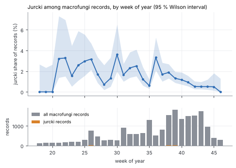
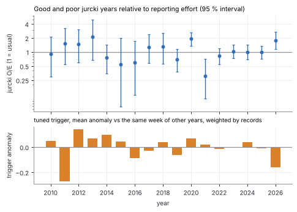
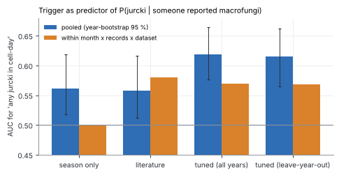
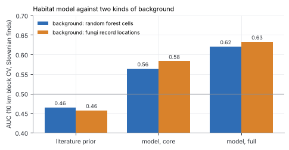
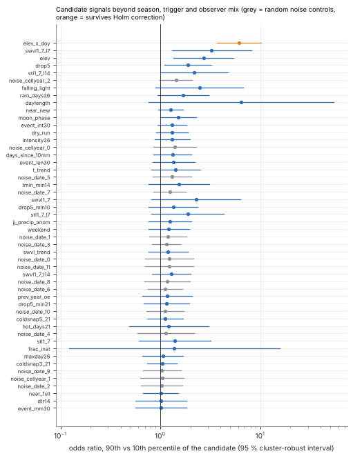
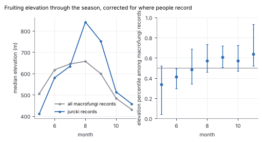

# Jurčki trends corrected for reporting effort

*Exploratory analysis by a worker agent; the numbers are reproducible with `python -m jurcki.model.effort`
(writes `data/processed/effort_results.json` and the figures in `docs/figures/`). Nothing here changes the default model.*

## 0. Summary

Presence-only finds mix "jurčki fruit here and now" with "someone was out looking and reported it". The cure
used here is the **target-group** approach: other macrofungi records reported by the same kind of observers
show where and when people were out; the question becomes **P(jurček | a macrofungus was reported)**.
The sample is small (**274 jurčki among 20,097 in-season macrofungi records, 4,718 cell-days of which
235 hold a jurček**; only 69 of them are Slovenian, most are Austrian), so almost everything has wide intervals.

* **Effort baseline.** Most "fungi" records near Slovenia are forest-pathology surveys, not foragers
  (86,732 cleaned records, but only 24,326 are usable baseline records; section 1).
  Using the unfiltered table inflates every AUC (section 2b contrast).
* **2a Seasonality.** Relative to other macrofungi, jurčki are most common in June-July (about 3 % of records) and
  thin out to 0.5 % in late October, because the autumn crowd of other species grows faster than jurčki.
  Effort-corrected "good years": **2020 (O/E 1.9) and 2026 so far (1.8)**; poor: **2021 (0.31)**; most other years are
  indistinguishable from 1. The model's yearly signal does **not** correlate detectably with the corrected ratio
  (Spearman +0.25, 95 % CI -0.33 to +0.73, n = 16 years).
* **2b Trigger.** As a predictor of P(jurček | macrofungi reported) the tuned trigger works modestly:
  pooled AUC **0.616** (leave-year-out) vs 0.562 season-only and 0.558 literature.
  The tuned-minus-season difference is 0.054 [0.004, 0.092]. The pure weather signal
  (AUC within month x records x dataset) is only ~0.57 for both the literature and the tuned trigger.
* **2c Habitat.** Against fungi-record locations as background the habitat model keeps its skill
  (full model 0.632 vs 0.620 with random forest cells; the literature prior stays at chance, 0.457); for the dated finds alone, the only
  subset that can be reporting-biased, it drops from 0.591 to 0.562 (n = 67).
  Against mycorrhizal-family or bolete locations it falls to 0.58 / 0.60, i.e. a part of the original skill is "forest vs not forest".
* **2d Trends.** 35 candidate signals tried (plus 15 random-noise controls, none of which reached p < 0.05).
  Nothing about the moon, cold snaps, rain-event shape, soil moisture, summer drought or the previous year's
  abundance is supported once season, trigger and observer mix are in the model. One signal survives multiple-testing
  correction: an **elevation x time-of-year interaction** (jurčki are over-represented at high elevation late in the season,
  at low elevation early). It helps held-out years, but not the find-day-vs-other-days metric (section 3).

## 1. The effort baseline

`python -m jurcki.sources.gbif_effort` scans the same GBIF AWS snapshot (2026-10-01, anonymous pyarrow S3, no other host)
for kingdom Fungi inside the bounding box, 2010+, and applies the cleaning of `gbif.clean` (full dates, <= 5 km, dedupe).
Output `data/processed/gbif_fungi.parquet`: **86,732 rows, 1.4 MB** (raw 94,090), columns
gbifid, species, genus, family, order, class, lat, lon, coordinate uncertainty, date, dataset, basis of record, country,
hashed recorder, is_jurcki. Counts: `data/processed/gbif_fungi_summary.txt`.

| country | records |
|---|---|
| SI | 51822 |
| AT | 27337 |
| HR | 6321 |
| HU | 891 |
| IT | 359 |
| FI | 1 |
| FR | 1 |

| dataset | records | jurčki | recorders | basis | top species |
|---|---|---|---|---|---|
| ebf3c079 | 45084 | 0 | 121 | OBSERVATION | Cryphonectria parasitica |
| 50c9509d | 17339 | 195 | 1460 | HUMAN_OBSERVATION | Trametes versicolor |
| 71d34a18 | 12634 | 81 | 121 | HUMAN_OBSERVATION | Trametes versicolor |
| 935c81fd | 6375 | 0 | 0 | MATERIAL_SAMPLE | Trametes versicolor |
| 8a863029 | 1009 | 6 | 404 | HUMAN_OBSERVATION | Fomitopsis pinicola |
| 55b9ac33 | 873 | 0 | 300 | PRESERVED_SPECIMEN | Russula romellii |
| fb8ae15d | 641 | 0 | 614 | PRESERVED_SPECIMEN | Muellerella erratica |
| d714382d | 579 | 0 | 13 | HUMAN_OBSERVATION | Amanita phalloides |

The raw table is dominated by forest-health survey datasets in Slovenia (chestnut blight *Cryphonectria parasitica*
27,870 records, ash dieback *Hymenoscyphus fraxineus* 9,981, Dutch elm disease *Ophiostoma novo-ulmi* 6,204; dataset `ebf3c079`,
45 k records, 0 jurčki, no mushroom hunters involved) plus material-sample / specimen collections (`935c81fd` 6.4 k records,
no recorders). They have no relation to foraging effort and are **not** the baseline.

**Target group used everywhere below** (`effort.load_fungi`):
1. `basisofrecord == HUMAN_OBSERVATION` (drops surveys `OBSERVATION`, `MATERIAL_SAMPLE`, `PRESERVED_SPECIMEN`);
2. class **Agaricomycetes** (fruiting bodies a forager notices; drops plant pathogens, lichens such as *Xanthoria* / *Flavoparmelia*, rusts, microfungi; it still contains
   bracket fungi, which people record but nobody collects, so the **mycorrhizal-family** and **Boletales** groups are run as sensitivity checks);
3. datasets with **>= 30 distinct recorders** (opportunistic reporting by many people, so a single person's itinerary or curated list does not
   masquerade as effort). That keeps iNaturalist `50c9509d` (1,185 recorders), the Austrian Mycological Society mapping `71d34a18` (111) and
   Observation.org `8a863029` (352) and drops six small sets (2-15 recorders; the largest, a Slovenian one with 495 records, has no jurčki at all among 495 records including 61 boletes, which looks like a curated list). Naturgucker
   does not occur in the box.
   The six in-season jurčki lost by this rule come from datasets with 8-15 recorders.

**Austrian OMG dataset (`71d34a18`, 10.5 k macrofungi records, 81 jurčki): kept.** It is a mycological-society survey, but its seasonal profile
is that of foragers (72 % of records in Aug-Oct, jurčki Jun-Oct like iNaturalist), it has ~111 recorders, a median of 2 records per recorder-day, and its
jurčki share (0.8 %) is lower than iNaturalist's, so it supplies negatives rather than inflating positives. It ends in 2023, which is why
the observed/expected ratios are stratified by dataset (iNaturalist / Observation.org / OMG) so that the change in who reports
does not look like a change in jurčki. Dropping it leaves the trigger result unchanged (table in 2b).

Baseline size per year (all seasons) as the filters are added:

| year | all fungi records | human observations | + Agaricomycetes | + >=30 recorders (baseline) | baseline, Slovenia | jurčki in baseline |
|---|---|---|---|---|---|---|
| 2010 | 1040 | 689 | 597 | 556 | 14 | 5 |
| 2011 | 1458 | 995 | 868 | 831 | 5 | 6 |
| 2012 | 2344 | 708 | 595 | 552 | 22 | 7 |
| 2013 | 8073 | 601 | 433 | 409 | 12 | 5 |
| 2014 | 7802 | 1771 | 1570 | 1541 | 26 | 9 |
| 2015 | 7198 | 794 | 649 | 559 | 16 | 2 |
| 2016 | 7657 | 773 | 634 | 608 | 19 | 3 |
| 2017 | 9925 | 960 | 828 | 723 | 61 | 9 |
| 2018 | 10139 | 1041 | 896 | 831 | 26 | 8 |
| 2019 | 8166 | 2816 | 2215 | 2164 | 195 | 14 |
| 2020 | 3404 | 2212 | 1771 | 1748 | 208 | 37 |
| 2021 | 1814 | 1618 | 1319 | 1309 | 164 | 5 |
| 2022 | 3324 | 3178 | 2467 | 2429 | 316 | 28 |
| 2023 | 4379 | 4070 | 3147 | 3091 | 779 | 43 |
| 2024 | 3640 | 3532 | 2692 | 2584 | 914 | 32 |
| 2025 | 4285 | 4223 | 3332 | 3286 | 1505 | 44 |
| 2026 | 2084 | 2023 | 1109 | 1105 | 383 | 25 |
| total | 86732 | 32004 | 25122 | 24326 | 4665 | 282 |

The baseline is small before 2019 (a few hundred records a year, 5-60 of them Slovenian) and grows ten-fold with iNaturalist after 2019;
Slovenian records are 3 % of the baseline before 2019 and 46 % in 2025.
Effort-corrected statements about early years therefore rest on a few hundred records.

## 2a. Effort-corrected seasonality and years



Jurčki share of macrofungi records per week of year (in-season, all countries; jurčki 274 of 20,097):

| week | records | jurčki | share % | 95 % interval |
|---|---|---|---|---|
| 18 | 140 | 0 | 0.0 | 0.0-2.7 |
| 19 | 160 | 0 | 0.0 | 0.0-2.3 |
| 20 | 141 | 0 | 0.0 | 0.0-2.7 |
| 21 | 155 | 5 | 3.2 | 1.4-7.3 |
| 22 | 183 | 6 | 3.3 | 1.5-7.0 |
| 23 | 193 | 3 | 1.6 | 0.5-4.5 |
| 24 | 194 | 5 | 2.6 | 1.1-5.9 |
| 25 | 303 | 9 | 3.0 | 1.6-5.5 |
| 26 | 755 | 24 | 3.2 | 2.1-4.7 |
| 27 | 465 | 8 | 1.7 | 0.9-3.4 |
| 28 | 276 | 2 | 0.7 | 0.2-2.6 |
| 29 | 304 | 4 | 1.3 | 0.5-3.3 |
| 30 | 277 | 10 | 3.6 | 2.0-6.5 |
| 31 | 902 | 15 | 1.7 | 1.0-2.7 |
| 32 | 604 | 14 | 2.3 | 1.4-3.9 |
| 33 | 598 | 15 | 2.5 | 1.5-4.1 |
| 34 | 651 | 8 | 1.2 | 0.6-2.4 |
| 35 | 1310 | 8 | 0.6 | 0.3-1.2 |
| 36 | 511 | 17 | 3.3 | 2.1-5.3 |
| 37 | 824 | 14 | 1.7 | 1.0-2.8 |
| 38 | 1540 | 29 | 1.9 | 1.3-2.7 |
| 39 | 1823 | 24 | 1.3 | 0.9-2.0 |
| 40 | 1364 | 16 | 1.2 | 0.7-1.9 |
| 41 | 1498 | 14 | 0.9 | 0.6-1.6 |
| 42 | 1514 | 8 | 0.5 | 0.3-1.0 |
| 43 | 1751 | 9 | 0.5 | 0.3-1.0 |
| 44 | 971 | 5 | 0.5 | 0.2-1.2 |
| 45 | 398 | 2 | 0.5 | 0.1-1.8 |
| 46 | 292 | 0 | 0.0 | 0.0-1.3 |

The share is highest in June and early July (weeks 21-26, ~3 %), drops in mid-July (week 28, 0.7 %, only 276 records),
and decays from ~2 % in August to ~0.5 % from week 42. The *absolute* number of jurčki records peaks in
weeks 36-40, but so does everything else: jurčki are a smaller part of the autumn crowd than of the summer crowd. A calendar built on
shares is therefore a different thing from `season_factor`'s step table (which peaks in September) and not a replacement for it.

**Good and poor years.** O/E = observed jurčki divided by the number expected from the week-of-year share of the other years
(leave-one-year-out), computed within dataset strata and shrunk towards the stratum mean, so seasonal shape, number of records and
dataset mix are removed. Interval: exact Poisson on the observed count.



| year | records | jurčki | expected | O/E | lo | hi | O/E autumn (wk 33-44) |
|---|---|---|---|---|---|---|---|
| 2010 | 507 | 5 | 5.41 | 0.92 | 0.30 | 2.16 | 1.91 |
| 2011 | 772 | 6 | 3.97 | 1.51 | 0.55 | 3.29 | 1.72 |
| 2012 | 541 | 7 | 4.67 | 1.50 | 0.60 | 3.09 | 1.32 |
| 2013 | 365 | 5 | 2.38 | 2.10 | 0.68 | 4.89 | 2.59 |
| 2014 | 1530 | 9 | 11.92 | 0.76 | 0.35 | 1.43 | 0.60 |
| 2015 | 536 | 2 | 3.60 | 0.55 | 0.07 | 2.00 | 0.65 |
| 2016 | 548 | 3 | 5.05 | 0.59 | 0.12 | 1.74 | 1.14 |
| 2017 | 652 | 9 | 7.05 | 1.28 | 0.58 | 2.42 | 1.49 |
| 2018 | 782 | 8 | 6.18 | 1.29 | 0.56 | 2.55 | 1.47 |
| 2019 | 2073 | 14 | 20.23 | 0.69 | 0.38 | 1.16 | 0.58 |
| 2020 | 1696 | 37 | 19.25 | 1.92 | 1.35 | 2.65 | 1.01 |
| 2021 | 1118 | 5 | 16.35 | 0.31 | 0.10 | 0.71 | 0.33 |
| 2022 | 1933 | 28 | 33.73 | 0.83 | 0.55 | 1.20 | 0.72 |
| 2023 | 2190 | 38 | 36.77 | 1.03 | 0.73 | 1.42 | 0.98 |
| 2024 | 1918 | 32 | 31.69 | 1.01 | 0.69 | 1.43 | 1.58 |
| 2025 | 2360 | 42 | 41.61 | 1.01 | 0.73 | 1.36 | 0.79 |
| 2026 | 576 | 24 | 13.31 | 1.80 | 1.16 | 2.68 | 2.75 |

* Clearly above 1: **2020** (1.92 [1.35, 2.65]) and **2026** (partial year, to 1 Oct).
  Clearly below 1: **2021** (0.31 [0.10, 0.71]). 2019, 2015, 2016 and 2014 lean low, the intervals include 1.
  Everything else is consistent with a normal year.
* No trend with calendar year (Spearman -0.19, CI -0.61 to +0.31), so the stratified ratio is not just
  following the growth of iNaturalist.

**Does the model's yearly signal match?** Two versions, both with the tuned parameters from `trigger_params.json`:
(i) the trigger's anomaly (value minus the mean of the same week in all years) at the places and dates where macrofungi were
reported, weighted by records; (ii) the mean season x trigger over a random sample of 800 Slovenian forest cells.
Spearman against the yearly O/E, 2010-2025 (n = 16; 2026 is partial), bootstrap interval over pairs:

| predictor | n | rho | lo | hi | p |
|---|---|---|---|---|---|
| model: tuned trigger anomaly at the places/dates of records | 16 | +0.250 | -0.334 | +0.732 | +0.350 |
| model: tuned season x trigger anomaly | 16 | +0.229 | -0.387 | +0.717 | +0.393 |
| model: literature trigger anomaly | 16 | +0.150 | -0.464 | +0.695 | +0.579 |
| model: mean season x trigger over Slovenian forest (May-Nov) | 16 | -0.091 | -0.601 | +0.446 | +0.737 |
| model: mean season x trigger over Slovenian forest (15 Aug-15 Oct) | 16 | -0.256 | -0.739 | +0.334 | +0.339 |
| Jun-Jul rain anomaly (z) at the places of records | 16 | +0.015 | -0.530 | +0.594 | +0.957 |
| previous year's ratio | 15 | +0.000 | -0.555 | +0.609 | +1.000 |
| calendar year | 16 | -0.194 | -0.613 | +0.309 | +0.471 |

All intervals contain 0 and are wide (+-0.55): with 16 years, only correlations above ~0.5 could be detected.
The effort-matched anomaly points the right way (rho ~ +0.25) but cannot be told from no relation; the Slovenian-forest mean does not at all.
The model's yearly spread is small (Slovenian-forest mean season x trigger 0.25-0.38), so most of the O/E variation (which also has Poisson noise of +-30-100 %) is not something it could explain.
For the autumn only (weeks 33-44):

| predictor | n | rho | lo | hi | p |
|---|---|---|---|---|---|
| Jun-Jul rain anomaly (z) at the places of records | 16 | -0.085 | -0.634 | +0.465 | +0.753 |
| model: tuned trigger anomaly | 16 | +0.094 | -0.478 | +0.592 | +0.729 |
| previous year's ratio | 15 | +0.157 | -0.362 | +0.671 | +0.576 |
| calendar year | 16 | -0.435 | -0.786 | +0.112 | +0.092 |

## 2b. The trigger as predictor of P(jurček | macrofungi reported)

Unit: **25 km cell x day** with >= 1 baseline record, May 1 - Nov 15 (4,718 cell-days in 75 cells, 235 positive).
Weather: ERA5 interpolated to the mean position of the cell's records and lapse-corrected to their median elevation (the recipe of `predict.py`).
Scores: season only (`season_factor`), literature parameters, tuned parameters from `trigger_params.json` (tuned on all finds,
so partly in-sample), and **tuned leave-year-out** (the parameters chosen by `trigger.loyo_select` without the held-out year's finds).
Pooled AUC has a year-bootstrap interval. Because busier cell-days are more likely to hold a jurček by chance, and because the
share drops through autumn, the right-hand columns compute the AUC only *within* strata of month, number of records and dataset, which isolates the weather.



| score | pooled AUC | lo | hi | mean per-year AUC | within #records | within month | within month x #rec x dataset | within cell |
|---|---|---|---|---|---|---|---|---|
| season only | 0.562 | 0.518 | 0.619 | 0.569 | 0.522 | 0.500 | 0.500 | 0.562 |
| literature trigger alone | 0.514 | 0.467 | 0.564 | 0.500 | 0.500 | 0.573 | 0.580 | 0.506 |
| literature (season x trigger) | 0.558 | 0.512 | 0.616 | 0.550 | 0.534 | 0.573 | 0.580 | 0.552 |
| tuned trigger alone | 0.599 | 0.539 | 0.662 | 0.561 | 0.577 | 0.563 | 0.569 | 0.618 |
| tuned, all years | 0.619 | 0.577 | 0.665 | 0.580 | 0.586 | 0.563 | 0.569 | 0.635 |
| tuned, leave-year-out | 0.616 | 0.565 | 0.663 | 0.572 | 0.599 | 0.564 | 0.569 | 0.638 |

Paired AUC differences (95 % year-bootstrap): pooled tuned-LOYO minus season 0.054 [0.004, 0.092];
literature minus season -0.004 [-0.031, 0.024]; tuned-LOYO minus literature 0.058 [0.009, 0.092].
Within strata: literature minus season 0.080 [0.021, 0.128]; tuned-LOYO minus literature -0.011 [-0.076, 0.046].

* **Season-only** (0.562) carries the calendar but nothing else, and by construction nothing within a month.
* The **literature** trigger (optimum 13 C) adds a real weather signal within a month (0.58) but loses it across months
  (it scores warm summer days low), so pooled it equals season-only.
* The **tuned** trigger (optimum 17.6 C) is the best pooled predictor (0.616 leave-year-out, 0.619 on all years) and
  is not better than the literature trigger on the pure weather signal (0.57 vs 0.58): its pooled advantage is a better *shape over the season*.
  This agrees with the presence-only evaluation (tuned LOYO 0.710 vs 0.672 literature vs 0.662 season) in direction and rough size, an independent confirmation
  that conditions on people being out.
* The weather signal is small in absolute terms: AUC 0.57 within month. A flexible model (LightGBM, leave-year-out) on effort variables + day of year + elevation reaches log-loss
  0.1677 and within-strata AUC 0.516; adding ERA5 dynamic features gives
  0.1657 and 0.567. Weather helps, but effort and place dominate P(jurček | reported).
* **Re-tuning on these labels** (400 candidates, leave-year-out selection on the within-strata AUC): held-out 0.563 vs 0.536 for the find-based tuned trigger and
  0.547 for the literature one (training AUC of the selected candidates 0.607: much of that is selection noise). A gain of ~0.02 over literature, no interval computed; not adopted, but worth repeating when more Slovenian records exist.

Sensitivity to the target group and country (AUC pooled with 95 %, and within strata):

| target group | cell-days (pos) | score | pooled AUC | 95 % | within month x #rec x dataset |
|---|---|---|---|---|---|
| macro, Slovenia + Austria | 4074 (213) | season only | 0.576 | 0.527-0.634 | 0.500 |
| macro, Slovenia + Austria | 4074 (213) | literature (season x trigger) | 0.562 | 0.522-0.614 | 0.578 |
| macro, Slovenia + Austria | 4074 (213) | tuned, leave-year-out | 0.616 | 0.561-0.666 | 0.560 |
| macro, Slovenia only | 1796 (66) | season only | 0.602 | 0.521-0.698 | 0.500 |
| macro, Slovenia only | 1796 (66) | literature (season x trigger) | 0.564 | 0.481-0.671 | 0.569 |
| macro, Slovenia only | 1796 (66) | tuned, leave-year-out | 0.641 | 0.567-0.733 | 0.549 |
| mycorrhizal families | 2146 (235) | season only | 0.530 | 0.486-0.592 | 0.500 |
| mycorrhizal families | 2146 (235) | literature (season x trigger) | 0.523 | 0.479-0.576 | 0.568 |
| mycorrhizal families | 2146 (235) | tuned, leave-year-out | 0.571 | 0.532-0.614 | 0.526 |
| boletes (Boletales) | 1073 (235) | season only | 0.510 | 0.464-0.569 | 0.500 |
| boletes (Boletales) | 1073 (235) | literature (season x trigger) | 0.562 | 0.517-0.617 | 0.607 |
| boletes (Boletales) | 1073 (235) | tuned, leave-year-out | 0.560 | 0.514-0.604 | 0.571 |
| iNaturalist only | 3877 (169) | season only | 0.562 | 0.514-0.620 | 0.500 |
| iNaturalist only | 3877 (169) | literature (season x trigger) | 0.543 | 0.481-0.609 | 0.580 |
| iNaturalist only | 3877 (169) | tuned, leave-year-out | 0.622 | 0.567-0.682 | 0.571 |
| without the Austrian OMG dataset | 4293 (174) | season only | 0.568 | 0.522-0.620 | 0.500 |
| without the Austrian OMG dataset | 4293 (174) | literature (season x trigger) | 0.549 | 0.484-0.621 | 0.579 |
| without the Austrian OMG dataset | 4293 (174) | tuned, leave-year-out | 0.623 | 0.566-0.680 | 0.568 |
| contrast: all fungi, all records (unfiltered) | 17399 (241) | season only | 0.608 | 0.566-0.663 | 0.500 |
| contrast: all fungi, all records (unfiltered) | 17399 (241) | literature (season x trigger) | 0.614 | 0.550-0.674 | 0.605 |
| contrast: all fungi, all records (unfiltered) | 17399 (241) | tuned, leave-year-out | 0.651 | 0.591-0.707 | 0.603 |
| contrast: macro, no recorder minimum | 5021 (241) | season only | 0.553 | 0.508-0.605 | 0.500 |
| contrast: macro, no recorder minimum | 5021 (241) | literature (season x trigger) | 0.549 | 0.500-0.600 | 0.581 |
| contrast: macro, no recorder minimum | 5021 (241) | tuned, leave-year-out | 0.609 | 0.558-0.653 | 0.570 |

* Slovenia only (66 positives) gives the same ordering (tuned 0.64 vs season 0.60) with wider intervals.
* Restricting to the mycorrhizal families or the boletes (denominators closer to jurčki hunters) reduces the pooled gain (season-only becomes useless, 0.51-0.53, as it should for relatives with the same season)
  and keeps a weather part (0.53-0.61 within strata).
* Without the Austrian OMG dataset the picture is the same. With no recorder minimum (the sets with 8-15 recorders) it is the same too.
* **Contrast: the unfiltered fungi table** (every record, forest-pathology surveys included) gives pooled AUCs of 0.61 / 0.67 (season / tuned): it is easier because survey days are weather-independent negatives, not because the model is better.

## 2c. Habitat against a target-group background

The original habitat evaluation ranks held-out finds against random forest cells. That rewards "where people go": near roads and towns the density of records is high. Here the held-out
presences are ranked against the **cells where non-jurčki macrofungi were recorded** (one entry per cell, forest cells as in the original domain), with the same 10 km block CV, 5 folds
and the same Slovenian (3 km disc) SFI sites. The habitat model itself is trained on random background (as shipped) or, as a variant, on the target-group cells.



| background | prior | core model | full model | full, dated Slovenian finds only | full, SFI sites only | full: top-20 % hit rate |
|---|---|---|---|---|---|---|
| random forest cells (original test) | 0.464 | 0.564 | 0.620 | 0.591 | 0.632 | 0.354 |
| fungi-record cells, same model | 0.457 | 0.583 | 0.632 | 0.562 | 0.662 | 0.393 |
| trained AND tested on fungi-record cells | 0.457 | 0.570 | 0.624 | 0.496 | 0.677 | 0.358 |
| trained on fungi-record cells, tested on random cells | 0.464 | 0.492 | 0.533 | 0.428 | 0.577 | 0.175 |

Dated Slovenian finds only (n = 67), prior / full model: random cells 0.557 / 0.591,
fungi-record cells 0.501 / 0.562.

* Pooled over all Slovenian units the shipped habitat model keeps its AUC against fungi-record cells (0.632 vs 0.620 before): it is not
  an artefact of "people go near roads". The pooled number mixes two kinds of units, though: the 162 Slovenian Forestry Institute sites (plot data, not subject to reporting bias) go **up**
  (0.632 to 0.662), the 67 dated GBIF finds (which *are* subject to it) go **down** (0.591 to 0.562; n = 67, interval wide). The honest reporting-bias-free skill for dated finds is therefore ~0.56.
  The literature prior stays below 0.5 (0.46): it prefers terrain where macrofungi are recorded less than elsewhere.
* Retraining on target-group cells does not help (0.624 vs 0.632 on the same test) and its maps are worse against random cells (0.53): the model learns
  contrast between jurčki spots and other-fungi spots, which are both forest, instead of forest vs not forest. It is not recommended.
* A stricter test uses only the mycorrhizal families (750 Slovenian cells) or the boletes (288) as background: AUC of the full model drops to **0.577 / 0.599** (core 0.54 / 0.56, prior 0.43 / 0.45).
  That is the honest "how well does it separate jurčki habitat from habitat of other forest mushrooms": a weak but real skill (CIs not shown: 229 Slovenian units, five folds, fold AUC 0.50-0.72).
* Without the forest restriction (fields and gardens count as background too) the full model gets 0.637, i.e. nothing more.

## 2d. Exploratory trends

**Exploratory, hypothesis-generating.** 35 candidate signals were tried (the family below), plus 15 random-noise controls (12 constant within a date, 3 constant within a cell-year).
Each candidate is added to a logistic model of P(any jurček in the cell-day) whose baseline holds month dummies, log(number of records), dataset mix, country and the tuned leave-year-out trigger.
It is judged by: the held-out (leave-year-out) log-loss gain per cell-day with a year-bootstrap 95 % interval; the odds ratio between the 90th and 10th percentile of the candidate with
a cluster-robust (by year) interval; the Wald p-value, then Holm-adjusted over all 35; and a split-sample check (fit on even years, test on odd years, and the reverse; both should be > 0).
Cluster-robust inference with 17 years is approximate; the noise controls give a reality check: 0 of 15 reached p < 0.05.
With 35 candidates, about 1.8 would reach p < 0.05 by chance; **5** did, **1** survive Holm.



| candidate | group | held-out log-loss gain x1e4 | odds ratio 90th vs 10th pct | p (cluster Wald) | p Holm | even->odd x1e4 | odd->even x1e4 |
|---|---|---|---|---|---|---|---|
| elev_x_doy | place | 26.4 [9.8, 48.6] | 6.14 [3.67, 10.28] | 3.54e-06 | 0.000177 | 27.5 | -16 |
| swvl1_7_l7 | soil | 1.1 [-18.2, 16.8] | 3.27 [1.30, 8.22] | 0.0209 | 1 | 2.85 | -21.3 |
| elev | place | 9.7 [-7.5, 33.8] | 2.71 [1.35, 5.45] | 0.0256 | 1 | 3.5 | 15.3 |
| drop5 | cold | 2.9 [-7.2, 13.2] | 1.90 [1.10, 3.27] | 0.0348 | 1 | 4.14 | 4.94 |
| stl1_7_l14 | soil | -0.6 [-8.5, 5.8] | 2.18 [1.01, 4.74] | 0.0475 | 1 | -8.33 | 1.64 |
| falling_light | calendar | 1.0 [-11.8, 13.0] | 2.46 [0.89, 6.79] | 0.101 | 1 | -1.16 | -36.8 |
| rain_days26 | rain | -1.0 [-10.2, 5.5] | 1.68 [0.93, 3.04] | 0.104 | 1 | 1.97 | 2.8 |
| daylength | calendar | 0.3 [-8.9, 9.7] | 6.47 [0.76, 54.80] | 0.106 | 1 | 2.65 | 3.26 |
| near_new | moon | -0.1 [-4.1, 3.8] | 1.27 [0.95, 1.70] | 0.123 | 1 | 1.5 | -7.38 |
| moon_phase | moon | -2.7 [-14.1, 8.4] | 1.51 [1.00, 2.28] | 0.13 | 1 | 0.661 | -9.04 |
| event_int30 | rain | 1.2 [-1.7, 4.2] | 1.31 [0.94, 1.82] | 0.135 | 1 | -0.706 | 1.49 |
| dry_run | rain | -0.3 [-5.2, 2.8] | 1.31 [0.91, 1.90] | 0.166 | 1 | -11.4 | 0.775 |
| intensity26 | rain | -0.0 [-3.2, 3.0] | 1.32 [0.88, 1.99] | 0.201 | 1 | -1.03 | -15.7 |
| days_since_10mm | rain | -0.6 [-4.8, 4.0] | 1.32 [0.86, 2.05] | 0.225 | 1 | -6.21 | 1.35 |
| event_len30 | rain | -0.3 [-7.2, 10.0] | 1.36 [0.84, 2.22] | 0.233 | 1 | -5.37 | -0.299 |
| t_trend | cold | -0.8 [-7.4, 5.1] | 1.43 [0.81, 2.53] | 0.237 | 1 | 1.79 | 2.02 |
| tmin_min14 | cold | -1.2 [-9.3, 4.2] | 1.53 [0.76, 3.08] | 0.25 | 1 | 1.02 | -2.23 |
| swvl1_7 | soil | -3.2 [-14.1, 7.8] | 2.28 [0.82, 6.38] | 0.316 | 1 | 2.15 | 1.24 |
| drop5_min10 | cold | -2.2 [-7.2, 1.3] | 1.35 [0.77, 2.36] | 0.318 | 1 | 0.785 | -17.9 |
| stl1_7_l7 | soil | -3.1 [-14.4, 5.8] | 1.88 [0.81, 4.34] | 0.361 | 1 | -4.82 | -0.569 |
| jj_precip_anom | year | -2.1 [-8.4, 1.6] | 1.25 [0.76, 2.03] | 0.392 | 1 | -1.13 | 3.86 |
| weekend | effort | -4.7 [-14.0, 6.6] | 1.22 [0.77, 1.94] | 0.418 | 1 | 0.242 | -8.5 |
| swvl_trend | soil | -1.2 [-3.1, 1.5] | 1.19 [0.76, 1.88] | 0.451 | 1 | -0.152 | 0.0178 |
| swvl1_7_l14 | soil | -6.7 [-12.7, -3.2] | 1.29 [0.83, 2.01] | 0.522 | 1 | -25.4 | -5.2 |
| prev_year_oe | year | -6.6 [-16.4, -0.4] | 1.18 [0.66, 2.08] | 0.584 | 1 | -11 | -50 |
| drop5_min21 | cold | -2.6 [-4.7, -0.6] | 1.16 [0.68, 1.96] | 0.593 | 1 | -0.0368 | -5 |
| coldsnap5_21 | cold | -3.5 [-8.8, -0.2] | 1.12 [0.74, 1.69] | 0.608 | 1 | -12.5 | -4 |
| hot_days21 | heat | -4.0 [-7.8, -0.4] | 1.22 [0.48, 3.05] | 0.683 | 1 | -1.97 | -8.63 |
| stl1_7 | soil | -6.1 [-14.1, -0.8] | 1.40 [0.61, 3.19] | 0.727 | 1 | -4.23 | -18.8 |
| frac_inat | effort | -1.7 [-3.0, -0.8] | 1.38 [0.12, 15.62] | 0.798 | 1 | -6.86 | -0.000136 |
| maxday26 | rain | -1.6 [-4.1, -0.5] | 1.06 [0.66, 1.70] | 0.821 | 1 | -0.119 | -4.37 |
| coldsnap3_21 | cold | -3.5 [-6.9, -0.9] | 1.04 [0.74, 1.46] | 0.823 | 1 | -11.7 | -0.0541 |
| near_full | moon | -2.5 [-3.8, -1.2] | 1.01 [0.67, 1.52] | 0.951 | 1 | -1.98 | -2.3 |
| dtr14 | cold | -2.5 [-4.4, -1.3] | 1.02 [0.57, 1.83] | 0.952 | 1 | -0.716 | -2.28 |
| event_mm30 | rain | -4.4 [-7.6, -1.9] | 1.01 [0.56, 1.82] | 0.97 | 1 | -2.05 | -4.34 |

(x1e4: gains are mean log-loss reductions per cell-day, multiplied by 10,000; the held-out log-loss of the baseline is about 0.16 per cell-day.)
Without the trigger in the baseline the picture is the same but `rain_days26`, `swvl1_7_l7` (rain / soil moisture a week ago), `hot_days21` and the tuned trigger itself
are significant: they are measuring the same wetness the trigger already uses (16 of 38 rows p < 0.05, 2 after Holm; the 38 rows are the 35 candidates plus 3 trigger variants).

### Plain-language findings (Slovene / English)

| Signal | Result | Slovensko | English |
|---|---|---|---|
| **Moon phase** (cos/sin, near full, near new; 8 phase bins) | held-out gain < 0, p = 0.13 (cos/sin), 0.95 / 0.12 (full / new); share per bin 1.0-1.6 %; pseudo-moon permutation p = 0.23; chi-square across the 8 bins p about 0.55 | Luna ne vpliva: delež jurčkov je skozi lunine mene (1,0–1,6 %) znotraj naključja. | No lunar effect: the shares across the lunar cycle are within chance (a "moon" with a random 20-40 day period fits as well). |
| **Cold snap after warm spell** (5-day mean minus previous 10-day mean; indicators >= 3 / 5 C within 21 days) | `drop5` OR 1.9 [1.1, 3.3], p = 0.035 but gain ~0 and Holm = 1; indicators OR 1.0-1.1, p > 0.6 | Hladen sunek po toplem obdobju ne sproži rasti; rahlo večji delež ob otoplitvi ni zanesljiv. | Cold snaps do not trigger flushes; a slightly higher share when warming is not reliable. |
| **Rain: size vs duration** (largest wet spell in 30 d: mm, days, mm/day; rain days, intensity, heaviest day, dry spell, days since 10 mm) | all p > 0.1 once the trigger is in; `rain_days26` is significant without it | Ni pomembno, ali dež pade v enem naletu ali v več dneh; pomembna je količina (že v sprožilcu). | Not the shape of the rain but the amount (already in the trigger). |
| **Soil moisture / temperature at lags 0, 7, 14 d** (linear + quadratic) | `swvl1_7_l7` p = 0.02 (Holm 1.0), `stl1_7_l14` p = 0.05; the rest p > 0.3; none helps held-out years | Vlaga in temperatura tal ne dodata nič k sprožilcu. | Soil adds nothing beyond the trigger. |
| **Preceding summer drought** (Jun-Jul rain z-score) | cell-day OR 1.25 [0.76, 2.0], p = 0.39; per year vs O/E rho = +0.01 (autumn weeks -0.09), CI +-0.55 | Suho poletje ne napove jesenskega deleža. | A dry June-July does not predict the autumn share (but n = 16 years only). |
| **Previous year's abundance** (log O/E of year before) | held-out gain < 0, p = 0.58; Spearman +0.00 [-0.56, +0.61], n = 15 | Dobra letina ne napove naslednje. | No carry-over from the previous year (large uncertainty). |
| **Day length** (and falling-light flag) | p = 0.11 / 0.10, CI of the OR spans 0.8-55; month dummies already hold it | Dolžina dneva ne doda nič poleg meseca. | Day length is the calendar again. |
| **Elevation of finds through the season** | jurčki sit lower than other macrofungi in May-June (percentile 0.34 / 0.41) and higher from August (0.57 / 0.61 / 0.57 Aug-Oct); `elev_x_doy` OR 6.1 [3.7, 10.3], Holm p < 0.001 | Jurčki se skozi sezono pomikajo v višje lege (maj–junij nižje od drugih gob, avgust–oktober više). | Relative to other fungi, jurčki are found low early and high late; the fruiting elevation rises through the season (section 3). |
| Weekend effort, dataset mix | p = 0.42 / 0.80 | Vikend in vir podatkov ne spremenita deleža. | No effect on the share. |
| Heat days, tmin, diurnal range, temperature trend | p 0.24-0.95 with the trigger | Nič poleg sprožilca. | Nothing beyond the trigger. |

### Elevation of finds through the season (corrected for where people record)



Percentile = position of each jurček's elevation (DEM) among all baseline records of the same month; 0.5 = as high as the typical macrofungus record.

| month | records | jurčki | median elev. all (m) | median elev. jurčki (m) | jurčki elev. percentile | lo | hi |
|---|---|---|---|---|---|---|---|
| 5 | 716 | 8 | 506 | 411 | 0.340 | 0.040 | 0.523 |
| 6 | 1482 | 44 | 618 | 581 | 0.411 | 0.297 | 0.495 |
| 7 | 1689 | 31 | 645 | 634 | 0.483 | 0.340 | 0.691 |
| 8 | 3418 | 51 | 657 | 842 | 0.572 | 0.461 | 0.732 |
| 9 | 5029 | 86 | 599 | 752 | 0.607 | 0.505 | 0.721 |
| 10 | 6568 | 50 | 483 | 514 | 0.570 | 0.469 | 0.724 |
| 11 | 1193 | 4 | 432 | 458 | 0.639 | 0.523 | 0.931 |

The percentile rises from 0.34 in May to 0.57-0.64 from August (the 95 % intervals exclude 0.5 in June, September and November; the Slovenian-only series, 69 jurčki, points the same way: August 0.58, September 0.61, October 0.69). That says jurčki are over-represented at the higher end of where macrofungi are recorded from August, but it mixes phenology (the flush moving uphill) with
habitat (spruce-beech belt at altitude vs. the lowland trails of iNaturalist users).

## 3. A robust-ish extra: `trigger.ELEV_SEASON` (optional, off by default)

The elevation x day-of-year interaction is the only signal that passes the correction (Holm p < 0.001; coefficient 0.52 per SD x SD in the same direction in Austria
(0.53, p < 0.001) and Slovenia (0.36, p = 0.08); these two country fits were run before the 30-recorder rule was added, with the small datasets still in). Held-out check (coefficient refitted without each year; factor = clip(exp(b z_elev z_doy), 0.5, 2) multiplied onto the tuned leave-year-out score):

| metric (target group, leave-year-out) | without | with | paired difference [95 % year bootstrap] |
|---|---|---|---|
| pooled AUC | 0.616 | 0.641 | 0.026 [0.012, 0.041] |
| AUC within month x records x dataset | 0.569 | 0.606 | 0.037 [0.002, 0.070] |
| AUC within cell (time only) | 0.638 | 0.643 | 0.005 [-0.015, 0.028] |
| AUC Austria / Slovenia | 0.623 / 0.627 | 0.638 / 0.634 | |
| leave-country-out log-loss | 0.3164 | 0.3158 | |

* It **improves the target-group prediction on held-out years** (+0.026 pooled AUC, +0.037 within strata) and transfers (slightly) across countries.
* The gain is between cells, not in time: within a cell the AUC gain is +0.005 (CI -0.015 to +0.028), and on the **presence-only find-day-vs-other-days metric the factor is neutral to negative**
  (mean percentile 0.722 vs 0.733, difference -0.011 [-0.024, +0.005]; `trigger.percentiles`, +-3 days). So it describes where jurčki are *relative to other fungi* at a given date; the habitat model (month-specific elevation optimum)
  is where it belongs, not the trigger.
* One of the two split-sample checks is negative (fit on odd years, test on even: -16 x 1e-4 per cell-day; the other way: +27 x 1e-4).

Hence: the flag exists (`trigger.trigger_scores(panel, p, elev_season=True)`, constants in `trigger.ELEV_SEASON`), the default model is untouched, and I would not switch it on without
more Slovenian data.

## 4. What is robust and what is noise

**Robust enough to act on**
* Effort has to be modelled: unfiltered fungi counts would flatter any weather model (contrast in 2b).
* The tuned trigger beats season-only and literature on a target-group test that conditions on people being out (+0.054 pooled AUC, 95 % CI 0.004 to 0.092), so the tuned parameters are not an artefact of the find-day metric.
* The habitat model's AUC does not depend on the random-forest background (0.62 -> 0.63 with fungi-record cells).

**Suggestive**
* Poor 2021 and good 2020 / 2026 relative to effort; the model's yearly anomaly leans the right way (+0.25) but cannot be distinguished from zero with 16 years.
* Elevation rises through the season relative to other fungi (section 3); the weather signal within month (AUC ~0.57) is the same for the literature and tuned triggers.
* Re-tuning on target-group labels (+0.02 over literature held-out).

**Noise / not supported**
* Moon phase, cold snaps, rain-event shape, soil moisture / temperature lags, summer drought, previous year, day length, weekend effort.

## 5. Suggestions

1. **Keep the tuned trigger and the default habitat model.** Consider adding a month-specific elevation optimum to the habitat map (it is what the interaction captures), evaluated against the target-group background.
2. **Collect effort where it is missing**: Slovenian foragers' reports (forums, gobarska drustva) with *all* species or at least "nothing found" days would give true negatives; only 69 Slovenian jurčki since 2010 are in GBIF.
3. Report the app's backtest on the target-group metric as well (AUC conditional on reports); it is much less sensitive to where and when people look.
4. Re-run this document as iNaturalist grows (2026 Slovenian baseline is already 383 records by 1 Oct); with ~3x the data the within-month AUC, the year ratios and the elevation shift can be pinned down.
5. Treat the share as relative abundance: it falls in October because other species fruit, not because jurčki do.

## Reproduction

```
source backend/.venv/bin/activate
python -m jurcki.sources.gbif_effort            # 20 min scan of the GBIF snapshot, writes data/processed/gbif_fungi.parquet
python -m jurcki.model.effort                   # ~6 min: writes data/processed/effort_results.json and docs/figures/*.png
pytest -q backend/tests/test_effort.py          # synthetic, offline
```
